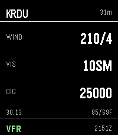
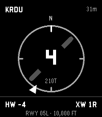
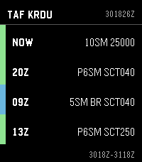
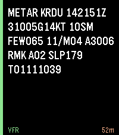

# Airport Wx

Airport Wx is a watchapp for the Pebble Time 2. It shows the latest METAR and
TAF for your airports.

> **WARNING:** This app is not a flight planning tool. Reports can be late,
> incorrect or missing. The runway on the Wind page is an estimate, not the
> active runway. The app uses the US flight category limits. Get an official
> weather briefing before each flight.

## Pages

|  |  |  |  |
| --- | --- | --- | --- |
| Home | Wind | TAF | Raw |

- **Home:** Wind, visibility (VIS), ceiling (CIG), altimeter setting,
  temperature and dew point. The header shows the airport and the age of the
  report. The footer shows the flight category and the observation time.
- **Wind:** A compass rose in degrees true, with a bar for the runway. The
  bottom line shows the headwind (HW) or tailwind (TW) and the crosswind (XW)
  with its side (L or R).
- **TAF:** One row for each forecast period. The color bar on the left shows
  the flight category. The first row (NOW) shows the observed category. An
  asterisk (*) identifies a TEMPO or PROB group.
- **Raw:** The full METAR text. Scroll a long report with Up/Down or a drag.

## Indications

| Indication | Meaning |
| --- | --- |
| Color block behind VIS or CIG | The flight category of that value is below VFR. |
| Amber value | The value is past one of your personal minimums. |
| Amber or red age | The report is old. You set the limits in the settings. |
| Turning ring next to the age | The app is loading new data. |
| Yellow X in the Home header | The watch has no connection to the phone. |

Category colors: VFR green, MVFR blue, IFR red, LIFR magenta. Only visibility
and ceiling can have a color block. The footer always shows the category name.

## Controls

| Control | Action |
| --- | --- |
| Up / Down | Show the previous or next airport. On the Raw page: scroll. |
| Select | Show the next page. |
| Hold Select | Show the nearest reporting station. |
| Back | Show the Home page. On the Home page: close the app. |
| Flick the wrist | Show the nearest reporting station, if this is on in the settings. |
| Swipe left / right | Show the next or previous page. |
| Drag up / down | Show the next or previous airport. On the Raw page: scroll. |
| Tap | Refresh the report. On the TAF page, also refresh the forecast. |

Touch operates only when touch is on in the watch settings
(Settings > Display > Touch).

## Settings

Open the app settings in the Pebble phone app.

- **Airports:** One home airport and up to four more, as ICAO identifiers (for
  example KRDU). With no airport set, the app shows the nearest reporting
  station.
- **Nearest station:** Always open on the nearest station, flick, search
  radius, time before the app returns to the home airport.
- **Runway:** Automatic or manual selection, calm-wind runway.
- **Units:** Altimeter, temperature, visibility, ceiling.
- **Personal minimums:** Wind, gust, crosswind, ceiling, visibility.
- **Refresh and alerts:** Refresh interval, age limits, vibration on a category
  change.

## Data and permissions

- **Weather:** NOAA Aviation Weather Center (aviationweather.gov).
- **Runways:** OurAirports (public domain). The data is in the app: 3,743 US
  airports.
- **Internet:** aviationweather.gov only. The phone blocks all other hosts.
- **Location:** Only when you request the nearest reporting station.

## Install

1. Download `airport-wx_<version>_emery.pbw` from the Releases page.
2. Open the file on your phone. The Pebble app installs it on the watch.
3. Optional: set your airports in the app settings. With no airport set, the
   app shows the nearest reporting station.

The app operates on the Pebble Time 2 (emery) only. For other install methods,
see [docs/INSTALL.md](docs/INSTALL.md).

## Build and test

The tests need Node.js 22 and gcc. A build needs the Pebble SDK.

```sh
npm test               # phone-side logic
npm run check-c        # watch C typecheck and gesture test
sh tools/setup-dev.sh  # install the SDK and the emulator (one time)
pebble build
pebble install --emulator emery
```

[docs/DEVELOPMENT.md](docs/DEVELOPMENT.md) describes the emulator, touch and
screenshot tools.

CI runs on each push and pull request:

| Job | Checks |
| --- | --- |
| `test` | Phone-side tests, C typecheck, gesture test. |
| `build` | A full build with the Pebble SDK (warnings are errors). |
| `smoke` | The app starts in the emulator and draws a frame. |

## Release

1. Set the version in `package.json`. Use the format `major.minor.0`.
2. Commit the change.
3. Push a tag with the same version:

   ```sh
   git tag v1.0.0 && git push origin v1.0.0
   ```

4. The Release workflow builds the `.pbw` and attaches it to a GitHub release.
   The workflow stops if the tag and `package.json` do not agree.
5. Publish to the Pebble app store. See [store/README.md](store/README.md).

## Project layout

| Path | Contents |
| --- | --- |
| `src/c/` | Watchapp: pages, drawing, touch, messages, storage. |
| `src/pkjs/lib/` | Phone-side logic: fetch, parse, units, categories, wind. |
| `src/pkjs/config/` | Settings page. |
| `test/` | Tests and real API responses (`test/fixtures/`). |
| `tools/` | Build, emulator, screenshot and asset tools. |
| `resources/images/` | Launcher icon (from `tools/make-icon.py`). |
| `store/` | App store text, icons, banner and screenshots. |
| `docs/` | Design, development and install documents. |

## Documents

- [docs/DESIGN.md](docs/DESIGN.md): Why the app shows weather the way it does.
- [docs/DEVELOPMENT.md](docs/DEVELOPMENT.md): SDK, emulator and test setup.
- [docs/INSTALL.md](docs/INSTALL.md): Install on a watch.

Not in this version: a companion watchface, density altitude, timeline pins and
non-US category limits.
