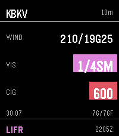
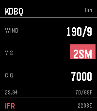
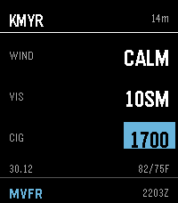

# Design

Why Airport Wx shows weather the way it does. The README describes what the app
does; this document explains the choices behind it.

## The number that limits you

The design premise is that **the number that limits you matters more than the
label derived from it**. So wind, visibility and ceiling are the three primary
values at 28pt, and the flight category is deliberately subordinate — spelled
out in the footer, and shown as a filled block on whichever value earned it.

There are exactly two visual encodings, and they never overlap in meaning:

| | Means |
| --- | --- |
| **A filled colour block behind a value** | That value's regulatory flight category is below VFR |
| **Amber text** | That value is past a limit *you* set in settings |

Only ceiling and visibility can ever carry a block, because only they determine
the category. Wind never does — colouring it green would imply wind affects
flight category, which it does not.

Colour is never the only carrier. The category is always spelled out, the
flagged value is the one with the block, and a TEMPO group is marked with an
asterisk as well as a colour. Roughly 8% of men have some form of colour vision
deficiency, and red-versus-green is precisely the common confusion axis.

Here is the rule doing its job on live reports:

| | | |
|---|---|---|
|  |  |  |

At KBKV the visibility is LIFR (1/4 SM) and the ceiling is only IFR (600 ft), so
the two values carry *different* colours and the worse one is obvious. At KDBQ
the ceiling is 7,000 ft and perfectly fine — the visibility alone is what makes
it IFR, so the ceiling carries no block at all. That is the whole design in two
screens: you see *which number* is the problem, not just that there is one.

## The pages

**Home** — station and data age in the header, then WIND, VIS and CIG, then
altimeter and temperature, then the category word and the observation time.

**Wind** — a compass rose in degrees *true*, with the runway drawn as a bar at
its true heading and labelled with its magnetic identifier. Head- and crosswind
components underneath, the crosswind with its side (`XW 7R`), because a bare
magnitude does not tell you which way to crab.

**TAF** — one row per forecast period with a category colour bar down the left.
The first row is `NOW` and shows the *observed* category, so the colour column
starts from reality rather than from what was forecast three hours ago.

**Raw** — the source METAR text, for the remark the display leaves out. It is
set large (Gothic 24 Bold); a long report scrolls with Up/Down or a drag. A
group too wide for a line is broken with a plain line break, never the hyphen
the text layout would add, because a hyphen means something in a METAR.

## The loading indicator

While a report, a forecast or a nearest-station lookup is in flight, a small
turning ring appears next to the age (or, on the TAF page, next to the issue
time). The reading underneath stays on screen while a newer one is fetched.
The phone tells the watch what it is working on. The watch shows the ring as
soon as you ask for something and drops it after 30 seconds if no answer
comes.

## Two things this app is careful about

**True versus magnetic.** METAR wind direction is degrees true. Runway numbers
painted on the pavement are magnetic. Mixing them silently introduces an error
equal to the local magnetic variation — around 10° over much of the US, which is
several knots of crosswind. Everything here computes in true, and the magnetic
identifier appears only as a label.

**Not knowing, versus knowing zero.** A missing ceiling is not an unlimited one.
A variable wind is not a calm one. An absent gust is not a gust of zero. Where a
value cannot be established the app says so and omits the derived figure, rather
than computing one from an assumption. That is why 282 US reporting stations
show a bare wind rose with no runway bar: their runway heading could not be
established from the source data, and a wrong crosswind is worse than none.

## Layout

Geometry is written against the Time 2's 200 × 228 and scaled to the real
bounds at draw time (`SX`/`SY` in `src/c/avwx.h`), so a port to a different
screen is a layout pass rather than a rewrite. Nothing reads a hardcoded 200 or
228, and no text baseline is hardcoded — every string is measured with
`graphics_text_layout_get_content_size` and centred on what came back.

## Architecture

```
┌─ Watch (C) ──────────────┐        ┌─ Phone (PebbleKit JS) ─────────────┐
│  4 pages, drawn from a   │        │  fetch METAR / TAF                 │
│    cached struct         │◄──────►│  parse, convert, categorise        │
│  Buttons, flick, age     │  App   │  wind trigonometry, runway choice  │
│  persist_read/write      │Message │  geolocation, Clay settings        │
└──────────────────────────┘        └────────────────────────────────────┘
```

All parsing, unit conversion, category derivation and wind trigonometry happen
on the phone. The watch receives pre-computed integers and short strings and
does nothing but draw them. **The watch never parses a raw METAR.** Watch RAM
and CPU are scarce, and a bug in the wind maths is then fixed without
reflashing.

That split is also why the tests are worth having: `src/pkjs/lib/` is plain
CommonJS with no Pebble dependency, so every rule in it — where a category
boundary sits, which layer is a ceiling, which runway end the wind favours, what
a TEMPO does to a row — is exercised directly against fixtures captured from the
live API.
